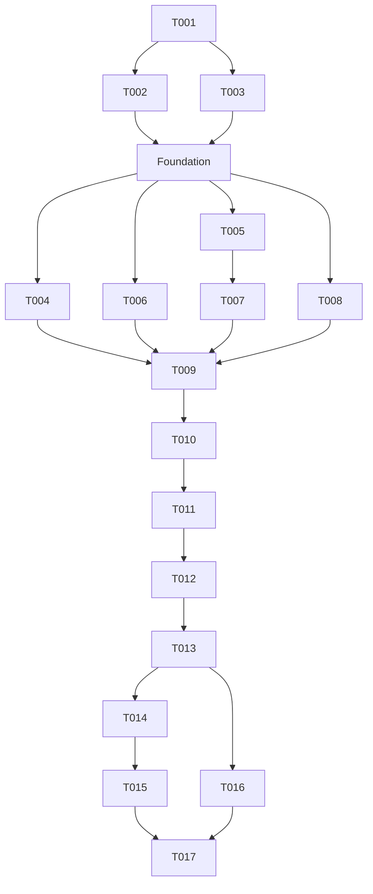

# Tasks: Fused Diarization

**Input**: [plan.md](plan.md), [spec.md](spec.md), [data-model.md](data-model.md), [research.md](research.md), [contracts](contracts/), [quickstart.md](quickstart.md).
**Status**: Implementation has not started. All paths below are relative to the repository root.

## Execution rules

Each checkbox is one independently reviewable outcome. Write behavior tests before production code within that task; tests are not separate handoffs. Running a test before implementation is optional under the constitution, except for a reproducing bug test. Verification compares the result with acceptance criteria and the approved design. Controlled fixtures verify project-owned behavior, not third-party model accuracy.

Root is Orchestrator. Each task receives a fresh Worker Wnnn and distinct Validator Vnnn; Wnnn submits implementation and evidence to Vnnn, and Vnnn reports independently to root. Model assignments, clean contexts and review cycles follow [the constitution](../../.specify/memory/constitution.md#sub-agents). A listed owner is a future assignment, not an agent already running. Do not edit AGENTS.md, sibling repositories or provision runtimes/assets.

Architecture classifications and entity relationships are [the plan's layer table](plan.md#entities-layers-and-relationships). New helpers must remain in the owning task's layer. Composition injects typed factories/converters into Infrastructure; Infrastructure imports neither Protocol nor Domain. Protocol performs no runtime I/O and imports no Domain types.

Assumptions are [the plan's assumptions](plan.md#assumptions-and-non-goals): prepared mono 16 kHz PCM16, one recording-local task, preinstalled pinned engines/assets, sufficient memory and GUI sequencing. Contract documents own numeric thresholds, resource rules and public grammar; this task list supplies implementation order and verification.

## Phase 1: Setup

Prepare only the small shared fixture API needed by parallel workers; specialized fakes belong to the tests that consume them. No installation work is needed.

- [ ] T001 Prepare shared controlled test inputs in `tests/support/diarization.py`.
  - Owner: W001 → V001; dependencies: none.
  - Acceptance: Provide reusable prepared-audio/manifest inputs, handwritten predictions and a simple ordered event log without engine imports or production-derived expectations. Reuse existing test helpers. Do not build a general fake-engine framework or separate fixture-contract suite; adapter-specific fakes are owned by T007/T008.
  - Order: Identify shared inputs required by downstream tests → verify: each helper has a named consumer; prepare minimal helpers → verify: imports require no native assets and expectations are independently calculated. Consumer tests verify the helpers through application behavior.

## Phase 2: Foundational prerequisites

These shared boundary values and I/O must be accepted before story execution. Tasks T002 and T003 have disjoint files.

- [ ] T002 [P] Implement provider results, failure distinctions and lazy prerequisite checks in `src/transcriber/infrastructure/diarization_provider.py`, `src/transcriber/infrastructure/diarization_prerequisites.py`, `tests/unit/infrastructure/test_diarization_provider.py`, `tests/unit/infrastructure/test_diarization_prerequisites.py`.
  - Owner: W002 → V002; dependencies: T001.
  - Acceptance: Immutable Python-owned runtime results preserve typed labels/timestamps. Missing secondary modules, solver, required eight model files and unavailable Vulkan are recoverable capability failures. Cancellation and cleanup failures are distinct. Checks are callable lazily, perform no installation and do not import optional modules at module import time.
  - Order: Write controlled result/import/asset/device tests → verify: failure classification and untouched lazy dependencies; implement values/checks → verify: focused tests and Infrastructure import boundaries pass.

- [ ] T003 [P] Implement canonical input decoding and publication wrapper in `src/transcriber/infrastructure/diarization_files.py`, `tests/unit/infrastructure/test_diarization_files.py`, `tests/integration/infrastructure/test_diarization_files.py`.
  - Owner: W003 → V003; dependencies: T001.
  - Acceptance: Reuse manifest-byte/WAV/writer boundaries. Validate prepared.wav containment, regular-file and symlink rules, mono/rate/PCM width, frame count and complete bytes. Decode once to contiguous 1D float32 using PCM16/32768, including zero samples. The publication wrapper delegates complete bytes to the existing writer and translates failures to publish without changing preparation behavior.
  - Order: Write controlled validation/decode and writer-delegation/failure-translation tests → verify: exact samples, one decode and wrapper behavior; implement I/O → verify: focused tests. Use one real-file integration case for valid input and delegated output; reuse existing filesystem/writer tests for atomic-write mechanics instead of duplicating their fault matrix.

## Phase 3: User Story 1 — Produce a speaker timeline (P1)

**Goal**: complete the successful two-engine path and final masked artifact.
**Independent test**: controlled full-recording predictions and a prepared directory produce exact canonical JSON, with no VAD or ASR invocation; evidence outside the mask participates in matching. This is the first demonstration increment, not a complete release before US2–US4.

Tests precede implementation inside each task below.

- [ ] T004 [P] [US1] Implement the pure speaker timeline from full predictions through final masking in `src/transcriber/domain/diarization.py`, `tests/unit/domain/test_diarization_fusion.py`, `tests/unit/domain/test_diarization_mask.py`.
  - Owner: W004 → V004; dependencies: T002, T003.
  - Acceptance: Typed predictions and sweep counters obey Fusion: clipping, duplicate labels, overlaps, rectangular one-to-one assignment, zero evidence, inclusive 3-second/70% thresholds, row denominator/maximum with 1e-9 tolerance, no reassignment, base preservation and eligible gap fills. Inject a typed solver callable and keep timestamps in seconds through fusion. Final conversion uses ties-to-even, clamping, collapsed-interval removal, exact mask splitting, touching-region merging, preserved IDs/overlaps and canonical sorting with no extra collar.
  - Order: Write hand-computed fusion tests → verify: matrix/threshold/fill expectations are independent; implement pure fusion → verify: base active-set preservation before masking; write sample/mask tests → verify: independent endpoints and union containment; implement conversion/masking → verify: both Domain suites pass. Fusion tests own agreement policy; masking tests own sample boundaries and permitted regions.

- [ ] T005 [P] [US1] Declare NeMo ABI structures and injected boundary conversions in `src/transcriber/protocol/nemo_diarization.py`, `tests/unit/protocol/test_nemo_diarization.py`.
  - Owner: W005 → V005; dependencies: T002, T003.
  - Acceptance: Native-aligned field types/order, sizeof prefixes and all symbol signatures match the pinned header. Configuration factories retain encoded strings, select v3-offline with left-context -1 and other overrides zero; result-copy helpers return Protocol values/primitives. No loader, native execution or Infrastructure/Domain dependency enters Protocol.
  - Order: Write layout/signature/config/copy tests → verify: comparison with pinned header and local ABI observations; implement declarations → verify: focused tests and architecture gate.

- [ ] T006 [P] [US1] Implement closed final artifact codec in `src/transcriber/protocol/diarization_json.py`, `tests/contract/test_diarization_json_contract.py`.
  - Owner: W006 → V006; dependencies: T002, T003.
  - Acceptance: The Artifact contract has exact closed keys/order, integer validation excluding booleans, sample time-base constants, positive IDs, compact UTF-8 with final LF and valid empty output. No intermediary or mode fields; Protocol receives boundary values rather than importing Domain.
  - Order: Write exact-byte and rejected-value contract tests → verify: handwritten JSON expectations; implement values/codec → verify: canonical bytes and malformed-input rejection.

- [ ] T007 [P] [US1] Implement direct NeMo ctypes inference and ownership in `src/transcriber/infrastructure/nemo_speech.py`, `tests/unit/infrastructure/test_nemo_speech.py`.
  - Owner: W007 → V007; dependencies: T005.
  - Acceptance: Generic injected factories/signatures configure the supported C ABI; create/open/push full shared audio/finish/query/fetch/copy occur in order. Returned intervals are Python-owned. Empty counts, status/error copying, cancelled/unknown status, partial handles and interruption are covered. Close stream before model destruction and free buffers before returning; wrapper cleanup failures remain fatal. No subprocess or engine output files.
  - Order: Write fake-native invocation/lifetime/status/interruption tests → verify: arguments, pointer ownership and event ordering; implement adapter → verify: focused tests and no Protocol/Domain imports.

- [ ] T008 [P] [US1] Implement direct Community-1 stages and Vulkan ownership in `src/transcriber/infrastructure/pyannote.py`, `tests/unit/infrastructure/test_pyannote.py`.
  - Owner: W008 → V008; dependencies: T002, T003.
  - Acceptance: Lazy pinned library invocation shares the same audio object, passes both count bounds equal to N and the supplied Vulkan index, and calls segment/extract_embeddings/cluster/reconstruct. Copy finite times/nonempty labels; valid empty/fewer-identity results remain valid. Release model references before close_vulkan, including partial construction, interruption and exceptions without traceback-retained models. No CPU retry.
  - Order: Write controlled stage/argument/result/ownership tests → verify: bounds, object identity and teardown order; implement adapter → verify: focused tests, cancellation distinction and architecture boundaries.

- [ ] T009 [US1] Assemble successful full-recording workflow with cleanup before publication in `src/transcriber/service/diarize_audio.py`, `src/transcriber/composition/application.py`, `tests/unit/service/test_diarize_audio.py`, `tests/unit/composition/test_diarization_application.py`.
  - Owner: W009 → V009; dependencies: T004, T006, T007, T008.
  - Acceptance: Composition supplies native factories/signatures, lazy solver and typed boundary-to-Domain/document mappings. Service performs common validation, sequential engines, observed distinct-ID count before mask, full fusion then exact mask and cleanup then atomic publication. Same decoded buffer reaches both adapters, no native values escape, successful reruns replace only final artifact. No fixed deadline; cancellation checks surround calls/stages/publication.
  - Order: Write Service ordering/audio-identity tests and Composition mapper/injection tests → verify: each suite owns its boundary; implement assembly/service → verify: correct argument/result mappings and cleanup before writer invocation. Test detailed timeline rules only in T004; cancellation/fatal paths belong to T012. Skip/fallback branches are completed in T011/T012.

- [ ] T010 [US1] Expose the separate diarization CLI and public message contract in `src/transcriber/protocol/diarization_cli.py`, `src/transcriber/controller/diarization_cli.py`, `src/transcriber/composition/application.py`, `pyproject.toml`, `tests/unit/controller/test_diarization_cli.py`, `tests/contract/test_diarization_cli_contract.py`, `tests/unit/test_package_metadata.py`.
  - Owner: W010 → V010; dependencies: T009.
  - Acceptance: Register transcriber-diarize while preserving dependency pins/override. Resolve work path and validate both independent GPU arguments/defaults, help and positional grammar. Controller calls Composition with typed values, flushes actual stage messages, sanitizes diagnostics, and renders final absolute result with contractual streams/statuses. No Controller Infrastructure import.
  - Order: Write public parser/output/entry-point contract tests → verify: invalid arguments exit 2 before inference and help loads no engines; implement command → verify: controlled US1 command exits 0 with contractual grammar. Controller unit tests cover only flushing/diagnostic sanitization not exercised by public tests. End-to-end GPU routing is verified in T013.

## Phase 4: User Story 2 — Avoid unnecessary secondary inference (P1)

**Goal**: implement empty-mask and zero/one observed-speaker skips.
**Independent test**: counters and forbidden-import fixtures show that empty masks check no engine/model/solver prerequisites, while zero/one-speaker results never touch Community-1 or fusion; output is correct without a warning.

- [ ] T011 [US2] Complete empty-mask and observed-count skip branches in `src/transcriber/service/diarize_audio.py`, `src/transcriber/composition/application.py`, `tests/unit/service/test_diarize_audio.py`, `tests/unit/composition/test_diarization_application.py`.
  - Owner: W011 → V011; dependencies: T010.
  - Acceptance: Empty union still validates common inputs and publishes empty activity without prerequisites/inference. Count uses distinct valid positive-duration clipped Nemotron IDs before masking; duplicate rows count once. Counts zero/one publish masked base activity, omit secondary/fusion stages and emit no fallback warning, even when all secondary dependencies are absent.
  - Order: Write skip/counter/forbidden-import tests → verify: selected callbacks remain untouched; implement branch/lazy wiring → verify: SC-002 and US1 regression tests.

## Phase 5: User Story 3 — Continue after a secondary failure (P2)

**Goal**: recover only from permitted secondary failures and preserve previous output on fatal paths.
**Independent test**: controlled missing dependencies/assets/device, inference exceptions and malformed results warn and publish masked Nemotron; cancellation, cleanup, fusion, mask, mandatory runtime and publication errors fail without replacing prior bytes.

- [ ] T012 [US3] Complete automatic fallback and fatal lifecycle handling in `src/transcriber/service/diarize_audio.py`, `src/transcriber/composition/application.py`, `tests/unit/service/test_diarize_audio.py`, `tests/unit/composition/test_diarization_application.py`.
  - Owner: W012 → V012; dependencies: T011.
  - Acceptance: Recoverable secondary failures produce the exact warning and successful base-only publication; valid empty/fewer-label/no-mapping results are normal fusion. Missing solver availability is secondary capability failure, but solver execution/first-party logic errors are fatal. Cleanup failures use owner stages nemotron/community1/mask and never fallback; cancellation remains fatal. All failure paths clean applicable resources and preserve prior artifact bytes.
  - Order: Write Service fault-injection tests using translated adapter failures → verify: fallback/fatal decisions, stage classification, no publication and prior-byte preservation; implement handling → verify: Lifecycle policy and US1/US2 regressions. Partial native construction/teardown mechanics remain in adapter unit tests; public warning/error rendering remains in T010 contract tests.

## Phase 6: User Story 4 — Select runtime GPUs (P2)

**Goal**: verify the separate GPU parameters reach independent native index spaces.
**Independent test**: a controlled CLI-to-adapter run observes defaults 0/0, NeMo -1 for CPU and distinct explicit indices without GPU hardware. Argument rejection is already covered by T010.

- [ ] T013 [US4] Add an assembled CLI-to-adapter GPU propagation check in `tests/contract/test_diarization_cli_contract.py`.
  - Owner: W013 → V013; dependencies: T012.
  - Acceptance: Controlled invocation of the real CLI/Composition wiring reaches both fake native boundaries with independently selected indices and defaults. Observe NeMo config.gpu and Community-1 gpu_index without real hardware. This verifies assembly; parser ranges/default validation belong to T010, adapter arguments to T007/T008, and unavailable-device policy to T012.
  - Order: Add parameterized assembled-command checks for defaults and distinct explicit indices (including NeMo CPU -1) → verify: both recorded native arguments match the command. Reuse existing fakes and avoid another parsing/device-failure matrix. Any discovered defect is returned to the owning implementation task rather than deferring its completion here.

## Phase 7: Acceptance and cross-cutting validation

Complete all four stories before declaring the feature ready. Documentation can proceed alongside controlled acceptance coverage; shared metadata changes remain sequential.

- [ ] T014 [P] Add representative assembled-command acceptance scenarios in `tests/acceptance/test_diarization_workflow.py`.
  - Owner: W014 → V014; dependencies: T013.
  - Acceptance: Three representative prepared-directory scenarios cover fused output with a successful rerun, an empty-mask skip, and automatic fallback. Exercise real assembly/file publication with fake engine boundaries; verify final artifact contents, public completion, unchanged inputs/Transcript and rerun replacement. The fused fixture includes pre-mask agreement evidence and overlapping identities. Do not repeat threshold/rounding, every skip variant, or the failure/cleanup matrix owned by focused tests.
  - Order: Add the three cross-boundary scenarios → verify: controlled artifact expectations and assembly behavior; execute acceptance tests → verify: all pass without real engines. Check requirement coverage against existing focused suites rather than creating another test for every FR/SC.

- [ ] T015 Add and run required real two-engine integration checkpoints in `tests/integration/infrastructure/test_nemo_speech.py`, `tests/integration/infrastructure/test_pyannote.py`, `tests/conftest.py`, `tests/unit/test_real_diarization_prerequisites.py`, `pyproject.toml`.
  - Owner: W015 → V015; dependencies: T014.
  - Acceptance: Introduce real_diarization marker and --real-diarization-required following existing conventions. Optional runs skip missing prerequisites; required runs fail on missing assets/hardware or absent actual adapter invocation. Explicitly invoke both real adapters and boundary mapping with supplied audio; Community-1 may receive a controlled valid count. Verify project-owned calls/settings/result types/ownership, not model accuracy. Skip/fallback cannot satisfy two-engine evidence.
  - Order: Write prerequisite/required-mode tests → verify: required mode cannot silently skip; implement checkpoint harness → verify: controlled prerequisite tests; run quickstart required command → verify: both actual integrations succeed or record the checkpoint as incomplete, never completed by fallback.

- [ ] T016 [P] Document the command and correct runtime availability guidance in `README.md`, `docs/cli.md`, `docs/diarization-runtime-setup.md`.
  - Owner: W016 → V016; dependencies: T013.
  - Acceptance: Usage, GPU flags, preinstalled requirements, mask/skips/fallback and output location match contracts. Replace stale missing-asset claims with current availability evidence without claiming inference from file presence. No installation, ASR or GUI changes. No new prose-presence test suite.
  - Order: Update guides → verify: examples agree with CLI help and contracts; check local links → verify: targets exist. Reuse CLI contract evidence for argument behavior.

- [ ] T017 Run final architecture, regression and design-traceability gates in `tests/architecture/test_layer_dependencies.py`, `specs/004-diarization/quickstart.md`, `specs/004-diarization/tasks.md`.
  - Owner: W017 → V017; dependencies: T015, T016.
  - Acceptance: SC-006 is satisfied: controlled suite, preparation/ASR regressions, architecture, ruff, mypy and lock check pass; required real evidence is present. Every task is compared with its criteria and approved contracts before acceptance. No hidden scope, runtime installs, AGENTS edits or changed preparation/Transcript contract.
  - Order: Run quickstart controlled commands plus uv lock --check → verify: successful checks; inspect final diff and task evidence → verify: per-task traceability, layer classification and required native checkpoint. Mark checkboxes complete only after Validator/root acceptance; unresolved real prerequisites leave T015/T017 incomplete.

## Dependencies and execution order

Story completion order: US1 → US2 → US3 → US4. Stories remain independently testable through controlled injections, but share Service/Composition files, so their integration work is sequential. Do not parallelize story phases that own those same files. Phase 2 must finish before Phase 3. Number order is the default sequential order; explicit dependencies permit earlier parallel dispatch.

## Parallel execution examples

- Foundation: W002 and W003 can work simultaneously after T001 acceptance.
- US1: after Foundation, W004 (Domain timeline), W005 (ABI declarations), W006 (artifact codec) and W008 (Community-1) own different files. Dispatch within agent capacity. W007 follows W005; native adapters remain disjoint. T009/T010 integrate sequentially.
- US2: T011 owns shared orchestration files; use one Worker, followed by its distinct Validator. No additional independent task is invented solely for parallelism.
- US3: T012 follows T011; one Worker/Validator pair covers fallback policy across shared wiring and Service tests.
- US4: T013 follows T012; one Worker/Validator pair checks assembled index propagation without reopening implementation. Do not overlap edits to the CLI contract suite.
- Final phase: W014 acceptance coverage and W016 documentation can run together after T013. T015 subsequently owns shared marker/metadata registration; T017 waits for both native evidence and docs.

Shared fixture changes must be coordinated through the Orchestrator after T001; accepted fixture APIs must not be edited concurrently. Workers only edit the files listed for their task. A necessary new file must be classified and reviewed against the existing design before inclusion.

## Implementation strategy and test plan

Deliver Foundation and US1 first for a controlled two-engine timeline demonstration. Validate US1 independently, then add US2 skips, US3 fault handling and US4 assembled GPU verification. US1 alone is the suggested MVP demonstration scope; all stories and final gates are required to release the agreed feature.

Test-first steps inside each task cover Domain sweeps/thresholds/masks, Protocol ABI/serialization/CLI, Infrastructure native calls and filesystem ownership, Service branches and Composition mappings. Acceptance tests connect the controlled boundaries. The separate real checkpoint verifies actual first-party runtime invocation on installed hardware. Use [quickstart.md](quickstart.md) for exact commands; real predictions are never an exact accuracy oracle.

## Test ownership

| Behavior | Owning task/suite | Additional boundary evidence |
|---|---|---|
| Prediction sweep, agreement, assignment and gap policy | T004 fusion unit tests | T014 uses one representative fused example, not a policy matrix |
| Rounding, mask union and merge/sort | T004 mask unit tests | T014 confirms assembled output |
| Closed JSON, rejected wire values and exact encoding | T006 artifact contract tests | T014 confirms the published artifact uses the codec |
| PCM validation/decode; writer delegation/stage translation | T003 I/O tests | Existing writer tests own atomic mechanics; T014 owns one rerun |
| ABI layout/config factories | T005 Protocol tests | T007 checks injected values are passed to native calls |
| Native call arguments, result copying and native cleanup | T007/T008 adapter unit tests | T015 alone owns real-runtime checkpoints |
| Missing prerequisites and translated failure values | T002 Infrastructure tests | T011/T012 verify branch selection and policy using those values |
| Stage ordering, shared audio, skips/fallback/fatal decisions | T009/T011/T012 Service tests | Composition tests cover mapping/lazy injection, not the same workflow matrix |
| CLI parsing, exact messages/statuses and registration | T010 CLI contract tests | Controller units only add flushing/sanitization; T013 owns assembled GPU propagation |
| Required/optional real-test gating | T015 prerequisite tests | Reuse runtime prerequisite checks, rather than retesting every asset/import case |

T017 runs existing checks and reviews coverage/evidence; it adds no duplicate test suite. Tests, implementation and focused verification stay within the same outcome. Documentation uses help/contract comparison and link checks, without tests tied to prose wording.
